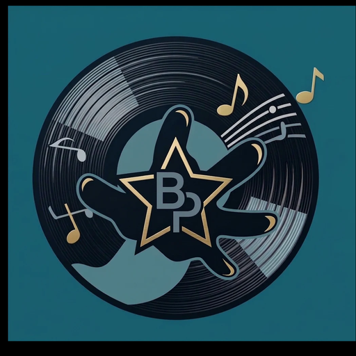

<p align="center"></p>
<h1 align="center"><b>Beyond Player</b></h1>
<h4 align="center">Un reproductor de música local para Android, con estilo propio. Fork personal de <a href="https://github.com/OxygenCobalt/Auxio">Auxio</a>.</h4>
<p align="center">
    <a href="https://github.com/DanielCorreaV/Beyond-Player/releases">
        
    </a>
    <a href="https://www.gnu.org/licenses/gpl-3.0">
        
    </a>
</p>

> [insertar imagen: collage o captura principal de la app, por ejemplo el inicio en estilo Neón o Pop]
> Archivo sugerido: `docs/images/portada.png`

## Acerca de

Beyond Player es un reproductor de música **local y sin conexión** basado en Auxio. Mantiene lo que hace bien Auxio (biblioteca rápida, reproducción sin cortes, etiquetas bien leídas) y le suma un sistema de estilos visuales, un reproductor con forma de Walkman, herramientas de sonido y la posibilidad de armar listas locales a partir de enlaces de YouTube Music.

La reproducción y la biblioteca no necesitan internet. Internet solo se usa en el momento puntual de importar una lista desde YouTube Music.

## Descargar

Los APK se publican en [Releases](https://github.com/DanielCorreaV/Beyond-Player/releases):

- **Pre-release (`vX.Y.Z-bN`)**: sale de la rama `releases`. Es para probar.
- **Release estable**: sale de la rama `master`.

Son APK de depuración. Si ya tienes instalada otra versión firmada con una clave distinta, Android no te dejará actualizar encima y tendrás que desinstalarla antes.

## Estilos

Beyond Player trae cuatro estilos que se eligen en **Ajustes → Personalizar**. Cada uno tiene versión clara y oscura.

| Estilo | Idea |
| --- | --- |
| **Clásico** | El aspecto original de Auxio, limpio y sobrio. |
| **Neón** | Oscuro con degradados luminosos, tarjetas y brillo alrededor de la carátula. Se inspira en reproductores modernos. |
| **Vinilo** | La carátula es un disco que gira, con surcos y brazo. Toma inspiración de la epoca de los discos de vinilo. |
| **Pop** | Colorido y juguetón, con tarjetas de borde grueso, sombras duras. Se inspira en la epoca de los 80s cuando el Walkman era el reproductor estrella. |

> [insertar imagen: los cuatro estilos lado a lado, mostrando la pantalla de inicio de cada uno]
> Archivo sugerido: `docs/images/estilos.png`

### Fondo personalizado

Puedes poner una imagen propia como fondo de la app. Las pantallas se vuelven translúcidas para que la imagen se vea detrás.

> [insertar imagen: la app con un fondo personalizado, por ejemplo el inicio o la lista de canciones]
> Archivo sugerido: `docs/images/fondo-personalizado.png`

### Estilo Neón

- Pantalla de inicio con buscador, **Seguir escuchando** (tus últimas canciones) y **Tus listas**.
- Tarjeta de reproducción compacta que flota sobre la lista.
- Reproductor con carátula grande, brillo suave y botones redondos.

> [insertar imagen: inicio en estilo Neón]
> Archivo sugerido: `docs/images/neon-inicio.png`

> [insertar imagen: reproductor en estilo Neón]
> Archivo sugerido: `docs/images/neon-reproductor.png`

### Estilo Vinilo

- La carátula se convierte en un disco que gira mientras suena la música y se detiene en pausa.
- Cabecera de inicio con la canción actual y las mismas herramientas del estilo Neón.

> [insertar imagen: reproductor en estilo Vinilo con el disco]
> Archivo sugerido: `docs/images/vinilo-reproductor.png`

> [insertar imagen: inicio en estilo Vinilo]
> Archivo sugerido: `docs/images/vinilo-inicio.png`

### Estilo Pop

- **Tarjeta rotativa en el inicio**, que se cambia deslizándola a los lados:
  - *Retoma donde quedaste*: tu última canción con su carátula.
  - *Descubre*: una canción al azar de tu biblioteca.
  - *Mezcla aleatoria*: toda tu biblioteca en modo aleatorio.
- **Reproductor Walkman** (ver más abajo).

> [insertar imagen: inicio en estilo Pop con la tarjeta rotativa, idealmente los tres modos]
> Archivo sugerido: `docs/images/pop-inicio.png`

## Reproductor Walkman

En el estilo Pop, el reproductor es un walkman de los 80:

- Cuerpo azul marino con franja de estado (indicadores decorativos y **contador de cinta** que avanza con la canción).
- **Casete** con etiqueta crema que muestra la carátula, el título y el artista, y una ventana con las **bobinas que giran** mientras suena la música.
- Indicador *SONANDO / EN PAUSA*, barra **TAPE POSITION** y teclas de control con tecla PLAY naranja.
- Toda la tarjeta del casete responde al **doble toque** a cada lado para adelantar o retroceder 10 segundos.
- El título de la barra superior muestra **BEYOND PLAYER**.

> [insertar imagen: el reproductor Walkman completo, con una canción sonando]
> Archivo sugerido: `docs/images/walkman.png`

> [insertar imagen (opcional): detalle del casete con las bobinas, o una captura en pausa]
> Archivo sugerido: `docs/images/walkman-casete.png`

## Herramientas de sonido

- **Ecualizador** de bandas integrado, con su propio diálogo.
- **Estabilizador de sonido** para parejar el volumen entre canciones.
- **Desvanecimiento entre canciones** y **crossfade** configurables.
- Soporte de ReplayGain y de ecualizadores externos, como en Auxio.

> [insertar imagen: el diálogo del ecualizador]
> Archivo sugerido: `docs/images/ecualizador.png`

## Temporizador de apagado

Programa que la música se detenga pasado un tiempo, con una opción para dejar que termine la canción en curso antes de parar.

> [insertar imagen: el diálogo del temporizador]
> Archivo sugerido: `docs/images/temporizador.png`

## Controles del reproductor

- **Doble toque** en la carátula (o en el casete en el estilo Pop) para saltar ±10 segundos.
- **Mantener pulsado** para reproducir a doble velocidad mientras se mantiene el dedo.
- Botón de **favoritos** en el reproductor y lista **Canciones que me gustan**.
- Botones de temporizador y sonido en la barra superior del reproductor.

## Importar listas de YouTube Music

Crea listas locales a partir de un enlace de YouTube Music **usando solo las canciones que ya tienes en el teléfono**:

1. Copia tus canciones a la carpeta Music del teléfono (Beyond Player la escanea como biblioteca).
2. En Beyond Player, elige *Importar desde YouTube Music* y pega el enlace de la lista.
3. La app empareja las canciones de la lista con las de tu biblioteca y crea la lista local.
4. Verás un resumen con las que se emparejaron y las que **faltan**.
5. Cuando consigas las que faltaban, vuelve a importar el mismo enlace: la lista se **actualiza sin duplicarse**.

No descarga música ni inicia sesión en YouTube: solo lee listas públicas.

> [insertar imagen: el diálogo de importación con el enlace pegado]
> Archivo sugerido: `docs/images/youtube-importar.png`

> [insertar imagen: el resumen de la importación con canciones emparejadas y faltantes]
> Archivo sugerido: `docs/images/youtube-resumen.png`

## Íconos de la app

El ícono por defecto es el logo de Beyond Player: un disco de vinilo con una estrella y las letras **BP**. Se puede cambiar por otros desde Ajustes. En Android 13 o superior hay también versión monocromática para íconos temáticos.

> [insertar imagen: el logo grande, o el selector de íconos en ajustes]
> Archivo sugerido: `docs/images/icono.png`

## Lo que viene de Auxio

- Reproducción basada en [Media3 ExoPlayer](https://developer.android.com/guide/topics/media/exoplayer) y reproducción sin cortes (gapless)
- Soporte de números de disco, varios artistas, tipos de lanzamiento, fechas, etiquetas de orden y más
- Sistema de artistas avanzado que unifica artistas y artistas del álbum
- Gestión de carpetas con soporte de tarjeta SD
- Listas de reproducción fiables y persistencia del estado de reproducción
- Compatible con Android Auto
- Carátulas incrustadas, búsqueda, autoplay con auriculares
- Widgets que se adaptan a su tamaño
- Completamente privado y sin conexión

## Permisos

- Almacenamiento (`READ_MEDIA_AUDIO`, `READ_EXTERNAL_STORAGE`) para leer y reproducir tus archivos
- Servicios (`FOREGROUND_SERVICE`, `WAKE_LOCK`) para mantener la música sonando en segundo plano
- Notificaciones (`POST_NOTIFICATION`) para mostrar la reproducción y la carga de la biblioteca
- Internet, solo para importar listas de YouTube Music

## Compilar

Beyond Player usa una versión parcheada de Media3 y taglib para leer etiquetas.

1. Instala `cmake` y `ninja-build`.
2. Clona con submódulos: `git clone --recurse-submodules https://github.com/DanielCorreaV/Beyond-Player.git`
3. Usa Linux (o WSL en Windows): el Media3 propio ejecuta scripts de shell que no funcionan en Windows.
4. NDK `28.2.13676358` y JDK 21.
5. El submódulo `media` debe estar en el commit `72d7aac` con `androidGradlePlugin = "9.4.1"` en `media/gradle/libs.versions.toml` (el repo de `media` trae `9.3.2` y choca con el del proyecto; el CI hace ese ajuste solo):
   ```bash
   git -C media checkout 72d7aacc93fe69e9b3afde1490e9daba568045ea
   sed -i 's/androidGradlePlugin = "9.3.2"/androidGradlePlugin = "9.4.1"/' media/gradle/libs.versions.toml
   ```
6. Compila con `./gradlew assembleDebug`.

Antes de subir cambios puedes comprobar formato y pruebas como lo hace el CI:

```bash
./gradlew spotlessCheck musikr:testDebug
```

## Ramas y publicación

| Rama | Para qué sirve | Qué hace el CI |
| --- | --- | --- |
| `dev` | Desarrollo diario | Revisa formato y pruebas, sin publicar nada |
| `releases` | Versiones de prueba | Compila y publica un **pre-release** con el APK |
| `master` | Versiones estables | Compila y publica un **release estable** con el APK |

También se puede publicar con un tag `v*`, o lanzar el workflow a mano desde la pestaña *Actions*.

## Créditos y licencia

Beyond Player es un fork de [Auxio](https://github.com/OxygenCobalt/Auxio), de Alexander Capehart ([@OxygenCobalt](https://github.com/OxygenCobalt)), cuyo trabajo hace posible este proyecto. Este fork incluye modificaciones propias: estilos, reproductor Walkman, herramientas de sonido, importación desde YouTube Music, íconos y cambios de interfaz.

Está bajo la licencia **GNU GPL v3**, igual que el original. Consulta [LICENSE](LICENSE) y [NOTICE](NOTICE). Las marcas y el logo de Auxio pertenecen a su autor; el logo de Beyond Player es propio.

---
